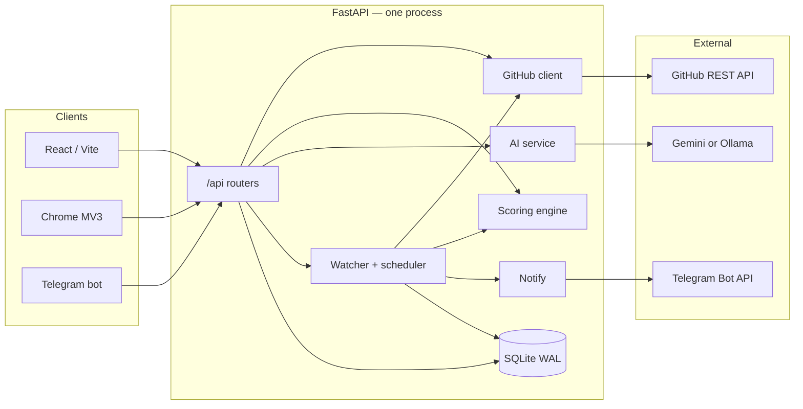
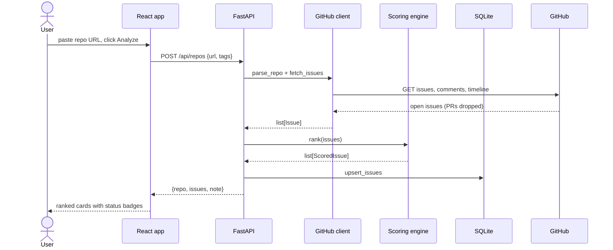
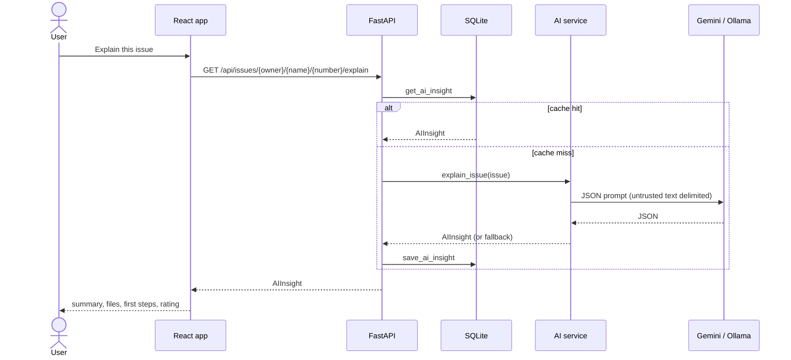
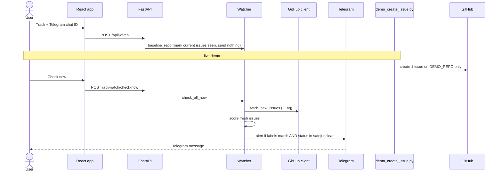
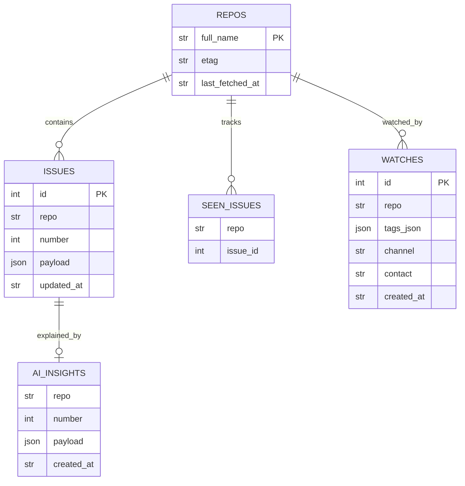

# WhatTheIssue / myOpenSource — Architecture & Build Plan

> Source of truth: [`agents/AGENTS.md`](agents/AGENTS.md) and the four part files.
> Event: Devf8rge × Hacktoberfest 2026 (Bengaluru). 4 people, ~10 hours.
> **Integration beats polish.**

---

## 1. What we are building

**myOpenSource** (repo name: WhatTheIssue) helps beginners find GitHub issues that are *actually* good to start on — and then watches repos for new ones.

**The problem:** GitHub `good first issue` labels lie. Issues get mislabelled, already claimed, abandoned, or written so vaguely that a beginner cannot start.

**The product:** paste a repo URL → we fetch open issues → we score each one as `safe` / `claimed` / `stale` / `unclear` → AI explains the issue in plain English and suggests starter tasks from the README → the user tracks the repo and gets a Telegram alert when a new matching issue appears.

**Pitch for judges:** *labels lie, so we check whether an issue is actually safe to start.*

**Surfaces (one FastAPI backend behind all of them):**

| Surface | Owner | Role |
|---|---|---|
| React web app | Part D | Primary UI: paste, rank, explain, track |
| Telegram bot | Part C | Alerts + `/track` `/list` `/untrack` |
| Chrome extension | Part C (P2) | Badge on GitHub repo pages |

The app is **read-only** toward third-party repos. The only write in the whole project is `scripts/demo_create_issue.py` against **our own** demo repo.

---

## 2. Architecture

```
 React web ───┐
 Chrome ext ──┼──► FastAPI backend ──► GitHub REST API (read-only)
 Telegram bot ┘      │      │
                     │      └──► LLM provider (Gemini Flash | Ollama local)
                     ▼
                  SQLite  ◄── scheduler polls tracked repos every N min
                     │
                     └──► notify: Telegram
```



### Request paths

**Analyze a repo (the core demo loop)**



**Explain an issue (lazy, cached)**



**Watch + Telegram alert (demo centrepiece)**



### Design principles

- One process, one SQLite file, no auth, no Docker, no microservices.
- Browser never talks to GitHub and never holds a token.
- Scoring is **pure and instant**. LLM is **never** on the list path.
- Blocking GitHub/AI work runs in a threadpool so FastAPI stays responsive.
- Scheduler and Telegram long-poll default **OFF**. Only the deployed server (and Part C when testing) turns them on. Two pollers on one bot token = Telegram 409.
- Issue and README text is untrusted: never execute it, never render as HTML, always delimit it in prompts.

---

## 3. Stack

| Layer | Choice | Why |
|---|---|---|
| Backend | FastAPI + uvicorn | Fast, typed, one-file deploy |
| DB | SQLAlchemy sync + SQLite WAL | Zero ops, scheduler-safe with `check_same_thread=False` |
| HTTP to GitHub | httpx | Read-only REST |
| Scoring | Pure Python | Deterministic, testable, no network |
| LLM | Gemini (cloud) **or** Ollama (local) | Switch with `LLM_PROVIDER` only |
| Scheduler | APScheduler | Poll every `POLL_INTERVAL_MINUTES` |
| Notify | Telegram Bot API | Demo-visible, no email for v1 |
| Frontend | Vite + React | Mock-first, `VITE_USE_MOCK` |
| Extension | Chrome Manifest V3 | P2 only |
| Deploy | Free host for API + Vercel for frontend | CORS via `FRONTEND_ORIGIN` |

---

## 4. Data model

Frozen in `backend/app/schemas.py` (Part A copies it verbatim). Additive-only after that.



### Domain objects

| Model | What it is |
|---|---|
| `Issue` | GitHub issue snapshot: labels, assignees, last ≤10 comments, `linked_pr_open` |
| `ScoredIssue` | `Issue` + `score` 0–100 + `status` + `reasons[]` + optional `ai` |
| `AIInsight` | Plain-English summary, files, skills, first steps, beginner rating 0–10 |
| `ReadmeSuggestion` | Beginner idea grounded in the README (`docs` / `tests` / `bugfix` / `feature` / `setup` / `other`) |
| `Watch` | Tracked repo + tags + Telegram chat ID |

### Status rules (checked in this order)

1. **claimed** — has assignees, OR an open linked PR, OR a non-maintainer comment in the last 14 days with a claim phrase ("I'll take this", "working on it", …). Maintainer-only claim phrases do **not** count.
2. **stale** — last activity older than 180 days.
3. **unclear** — body shorter than 40 characters after strip.
4. **safe** — everything else.

`rank()` orders `safe → unclear → stale → claimed`, then score descending inside each bucket.

Sample fixture expectations (`sample_issues.json` / `fixtures/sample_issues.json`):

| id | title | expected status |
|---|---|---|
| 101 | Fix typo in installation docs | `safe` |
| 102 | Add unit tests for the date parser | `claimed` (assignee + open PR) |
| 103 | Improve error message when config file is missing | `stale` (2025 dates) |
| 104 | "fix it" / "broken" | `unclear` |

---

## 5. REST contract

Base path `/api`. JSON in, JSON out. Default tags = `["good first issue"]`.

| Method | Path | Returns |
|---|---|---|
| GET | `/api/health` | `{"status":"ok"}` |
| POST | `/api/repos` | `{repo, issues: ScoredIssue[], note}` |
| GET | `/api/repos/{owner}/{name}/issues` | `ScoredIssue[]` (5-min cache; live-fetch if unknown) |
| GET | `/api/repos/{owner}/{name}/suggestions` | `ReadmeSuggestion[]` (1-hour cache) |
| GET | `/api/issues/{owner}/{name}/{number}/explain` | `AIInsight` (DB-cached) |
| POST | `/api/watch` | `Watch` + runs `baseline_repo` |
| GET | `/api/watch?contact=` | `Watch[]` |
| DELETE | `/api/watch/{id}` | `{"ok": true}` |
| POST | `/api/watch/check-now` | `{"checked": n, "notified": m}` |

Errors: HTTP status + `{"error": {"code", "message"}}` with codes `INVALID_REPO` (400), `REPO_NOT_FOUND` (404), `RATE_LIMITED` (429), `UPSTREAM_ERROR` (502).

Changing the contract is **additive only**, via a PR titled `contract: ...`.

---

## 6. Repo layout and ownership

```
myopensource/
├─ AGENTS.md / agents/          shared contract (this repo currently keeps them under agents/)
├─ README.md                    D
├─ CREDITS.md                   everyone appends; D curates
├─ LICENSE, .gitignore, .env.example   A
├─ fixtures/sample_issues.json  shared, read-only
├─ scripts/demo_create_issue.py C
├─ docs/demo-script.md          D
├─ backend/
│  ├─ requirements.txt          append-only
│  ├─ tests/                    test_<part>*.py only
│  └─ app/
│     ├─ main.py, config.py, schemas.py     A
│     ├─ api/                               A
│     ├─ db/        models.py, crud.py      A
│     ├─ github/    client.py, labels.py    A
│     ├─ scoring/   engine.py               B
│     ├─ ai/        service.py, prompts.py, providers/  B
│     ├─ watcher/   service.py              C
│     └─ notify/    telegram.py, telegram_bot.py        C
├─ frontend/                    D
└─ extension/                   C
```

**Stay in your lane.** Need something from another part? Leave `# NEEDS-FROM-PART-X:` and ping the human. Never wait — code against the contract and `sample_issues.json`.

Git: branches `a/…`, `b/…`, `c/…`, `d/…` → PR to `main` at least hourly. Commit style: `part-x: what changed`.

---

## 7. Workstreams

### Part A — Core backend (the spine)

Owner is the integration lead (resolves conflicts, keeps `main` bootable).

| Step | When | What |
|---|---|---|
| **A0 Skeleton (P0)** | 12:30 AM | Layout, MIT licence, schemas verbatim, label helpers, stubs for B/C, all API paths with exact shapes, `test_health.py`. Push to `main`. Everyone pulls. |
| **A1 GitHub client (P0)** | 2:30 AM | `httpx`, parse repo URLs, fetch issues (drop PRs), comments (≤10, concurrency ~8), linked-PR from timeline, README raw, ETag 304 path, typed errors. GET only. |
| **A2 DB (P0)** | 2:30 AM | SQLAlchemy + SQLite WAL. Tables: repos, issues, seen_issues, ai_insights, watches. Every crud function opens its own session. |
| **A3 Orchestration (P0)** | 3:30 AM | Wire endpoints: fetch → rank → upsert. 5-min issue cache. Explain + suggestions caches. Threadpool for blocking calls. Global error handler. |
| A4 (P1) | later | Rate-limit messages, deploy backend, scheduler/bot flags ON only on the host. |
| A5 (P2) | if time | Per-IP throttle so strangers cannot burn GitHub quota. |

Label matching lives here and is shared: `normalize_label` (lowercase, `-`/`_` → space) + `labels_match` (any tag equals any label). Nobody reimplements it.

### Part B — Scoring + AI (the brain)

| Step | When | What |
|---|---|---|
| **B1 Scoring (P0)** | 2:30 AM | Pure `score_issue` / `rank`. Named weight constants. Reasons written for beginners (max 6). Tests against sample fixtures + edges. |
| **B2 Explain (P0)** | 5:30 AM | Gemini + Ollama providers behind `LLMProvider.generate`. JSON-only prompt, injection delimiters, pydantic validate, one retry, then heuristic fallback. Never raises. LRU cache `(repo, number, updated_at)`. |
| **B3 README suggestions (P1)** | after B2 | 3–5 ideas grounded in README; `[]` if empty. |
| Tests | with each step | Mock the provider. Cover valid JSON, retry, exception → fallback, empty README, `"Ignore previous instructions…PWNED"`. |

Do **not** call the LLM from `score_issue`. The list endpoint must stay instant.

### Part C — Watcher, Telegram, demo, extension

| Step | When | What |
|---|---|---|
| **C0 Demo repo (P0)** | first 15 min | Public `myopensource-demo`. 5 hand-made issues covering safe / claimed / unclear. Separate `DEMO_GITHUB_TOKEN` with issues:write on that repo only. |
| **C1 Watcher (P0)** | 7:30 AM | `baseline_repo` (seen, no send). `check_all_now` (ETag, score fresh, notify only `safe`/`unclear` + matching labels, never twice). Scheduler gated by env. Isolate per-repo failures. |
| **C2 Telegram (P0)** | with C1 | `sendMessage`, HTML-escaped titles. Bot commands: `/start` (print chat ID), `/track`, `/list`, `/untrack`. One poller only. |
| **C3 Demo script (P0)** | 20 min | Creates **one** labelled issue on `DEMO_REPO`. Refuses any other target. |
| C4 Extension (P2) | 7:30–8:30 AM only | MV3 badge on repo pages. Fetch via service worker. Track + open web app. No `innerHTML`. |

Demo loop to rehearse: track demo repo → run script → Check now → Telegram ping on a phone.

### Part D — Frontend, README, demo script

| Step | When | What |
|---|---|---|
| **D0 Mock-first (P0)** | immediately | Copy fixtures into `frontend/src/mock/`. Single `src/api.js` with `VITE_USE_MOCK=1`. Real backend is a one-line env flip. |
| **D1 Screens (P0)** | 3:30 AM | Home (URL + tag chips + Analyze). Results (Issues / From the README, badges, reasons, lazy Explain). Track form + Check now. Default filter: `safe` + `unclear`. |
| **D2 Quality (P1)** | 3:30–7:30 | Skeletons, empty, error codes, offline, plain-text only, phone layout, focus states. |
| D3 Polish (P2) | after 7:30 | Wordmark, how-it-works strip. |
| **D4 Docs (P0)** | 9:00 AM | README (what / setup / contributing / limits / credits). `docs/demo-script.md` with a screen-recording backup. Deploy frontend. |

---

## 8. Night timeline

| Time | Milestone | Who |
|---|---|---|
| 12:30 AM | Skeleton on `main`. Everyone pulls. | A |
| 2:30 AM | Scoring merged. Real GitHub fetch merged. UI works on mocks. | B, A, D |
| 3:30 AM | **E2E:** paste repo → ranked list in the UI. | A + B + D |
| 5:30 AM | AI explanations in the UI. | B + D |
| 7:30 AM | **Watcher + Telegram live.** `POST /api/watch/check-now` works. | C |
| 8:30 AM | **Feature freeze.** Extension is in or out. Bugs only. | all |
| 9:00 AM | Deployed, README done, demo rehearsed. | A + D |

---

## 9. Environment

Copy `env.example` → `.env`. Never commit `.env`.

| Variable | Purpose |
|---|---|
| `GITHUB_TOKEN` | Read-only / no-scope token for public repos |
| `DATABASE_URL` | `sqlite:///./myopensource.db` |
| `LLM_PROVIDER` | `gemini` or `ollama` |
| `GEMINI_API_KEY` / `GEMINI_MODEL` | Cloud LLM (verify current free-tier model name) |
| `OLLAMA_URL` / `OLLAMA_MODEL` | Local open-weight story |
| `TELEGRAM_BOT_TOKEN` | Bot API |
| `ENABLE_SCHEDULER` / `ENABLE_TELEGRAM_BOT` | `0` locally, `1` only on the deployed server |
| `POLL_INTERVAL_MINUTES` | Default 10 |
| `DEMO_REPO` / `DEMO_GITHUB_TOKEN` | Write token scoped to our demo repo |
| `FRONTEND_ORIGIN` | CORS origin, default `http://localhost:5173` |
| `VITE_API_BASE` / `VITE_USE_MOCK` | Frontend only |

---

## 10. Event rules (non-negotiable)

1. Public repo, OSI licence (**MIT**) from the start.
2. Built here — small commits with real messages. No pasted old projects.
3. Credit everything in `CREDITS.md` (one line per library / API / AI tool).
4. Fork, don't spam. Read-only toward other people's repos.
5. No secrets in git. `.env` gitignored; `env.example` placeholders only.
6. Issue/README text is untrusted. No HTML render, no prompt-injection override.

---

## 11. Definition of done (the demo)

A judge can:

1. Paste a real public repo URL.
2. See a ranked list: green `safe`, grey `unclear`, amber `stale`, red `claimed`, with human reasons.
3. Click **Explain this issue** and get a plain-English summary + first steps.
4. See README-derived starter ideas when labels yield nothing.
5. Track the demo repo with a Telegram chat ID.
6. Watch `scripts/demo_create_issue.py` create one issue → **Check now** → a Telegram message arrives on a phone.
7. Hear one line: scoring is heuristic, AI can be wrong, and `LLM_PROVIDER=ollama` runs locally.

Backup: screen recording of the same flow if GitHub/Telegram is down.

---

## 12. Current repo state (2026-10-30)

The GitHub repo is the **work-allotment pack**, not the app yet.

Present:

- `agents/AGENTS.md` + PART-A/B/C/D
- `env.example`
- `sample_issues.json`
- stub `README.md`

Not yet present (Part A skeleton must create these):

- `backend/`, `frontend/`, `extension/`, `fixtures/`, `scripts/`, `docs/`
- `LICENSE`, `.gitignore`, `.env.example` (currently `env.example`), `CREDITS.md`

**Immediate next action:** Part A pushes the skeleton to `main` so B, C, and D can code against stubs without waiting.
